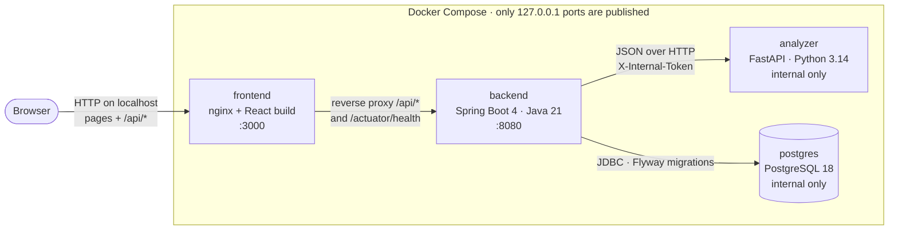
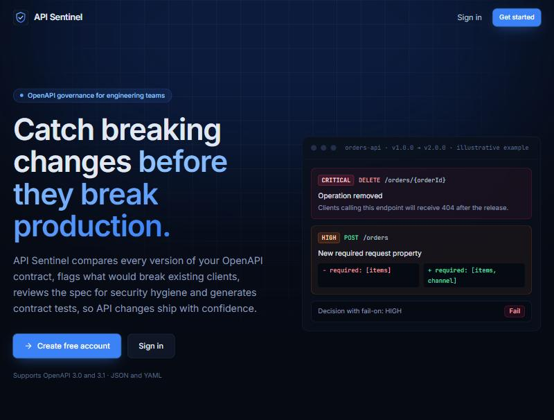
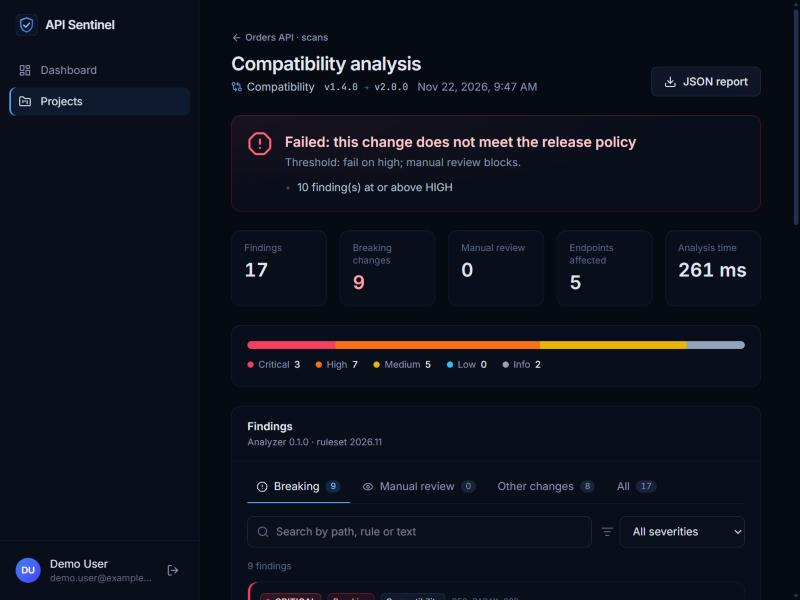
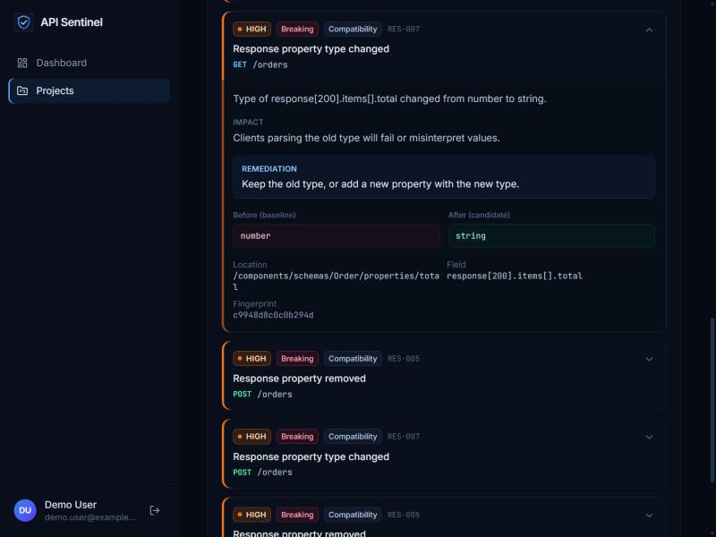
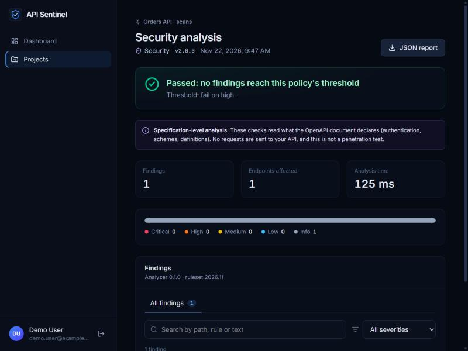
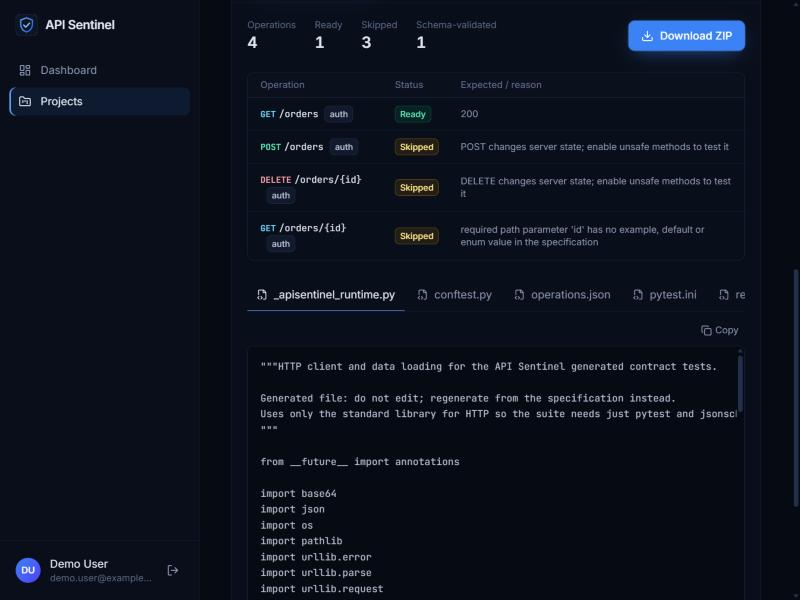

# API Sentinel

[](https://github.com/aninditamondal303/API-Sentinel/actions/workflows/ci.yml)

**Catch breaking changes before they break production.**

API Sentinel compares two versions of an OpenAPI specification and tells you, before you release, which changes would break existing clients. It also reviews a single specification for security hygiene problems and generates a runnable `pytest` contract-test suite from it. Every result is stored per project, so a team has a history of what changed between API versions and why a release passed or failed.

**[Live demo](https://api-sentinel-app.onrender.com/)**

> **For recruiters:** a full-stack system in three languages: React, a Spring Boot REST API with JWT and Flyway, and a Python FastAPI analysis service, with PostgreSQL, all in Docker Compose. 73 deterministic rules and 469 automated tests, including Testcontainers integration tests against real PostgreSQL and the real analyzer container.

> **Status:** a complete portfolio project, deployed live on Render (frontend, backend, analyzer and database also run together locally in Docker Compose). It is **not** production-hardened. See [Limitations](#limitations).

**At a glance**
- Three services in three languages (React/TypeScript, Java/Spring Boot, Python/FastAPI) plus PostgreSQL, started with one command.
- 73 deterministic analysis rules with severity, impact and remediation for every finding.
- 469 automated tests (372 analyzer, 54 backend, 43 frontend); backend integration tests run against real PostgreSQL and analyzer containers.
- Security by default: secrets only in a git-ignored `.env`, per-user data isolation, internal services never exposed to the browser, strict Content-Security-Policy.

---

## Contents

- [The problem](#the-problem)
- [Features](#features)
- [Architecture](#architecture)
- [Technology stack](#technology-stack)
- [How it works](#how-it-works)
- [Getting started (Windows)](#getting-started-windows)
- [Testing](#testing)
- [Example: the Orders API](#example-the-orders-api)
- [Security design](#security-design)
- [Design decisions](#design-decisions)
- [Project structure](#project-structure)
- [Screenshots](#screenshots)
- [Limitations](#limitations)
- [Future improvements](#future-improvements)

## The problem

Public and internal APIs are contracts. Renaming a path parameter, making a query parameter required, removing an endpoint or narrowing a response type all look harmless in a pull request, but each one can break clients that already depend on the API. These problems are usually found by the consumers, after the release.

OpenAPI specifications already describe the contract precisely, so the comparison can be automated. API Sentinel does that comparison deterministically, explains every finding (what changed, the impact on clients, how to fix it) and turns the result into a clear release decision against a configurable severity threshold.

## Features

**Compatibility analysis (baseline → candidate)**
- 55 compatibility rules covering operations, parameters, request bodies, responses, authentication and items that need manual review.
- Direction-aware schema comparison: request and response schemas are judged from the client's side. A request property that becomes required breaks existing callers, while for responses the risky change is the opposite one, a property that is no longer guaranteed to be present.
- Each finding carries severity (`CRITICAL` → `INFO`), the affected endpoint, a JSON-pointer location, before/after values, impact and remediation text.
- Pass/fail decision against the project's policy: a severity threshold and an optional "fail on findings that need manual review".

**Security review (single specification)**
- 4 security-regression rules applied during comparisons (for example, a security requirement removed from an operation) and 14 hygiene rules for a single spec (for example, an operation explicitly marked public).
- Clearly labelled as **specification-level analysis**: it reads what the OpenAPI document declares. It does not send requests to your API and is not a penetration test.

**Contract-test generation**
- Generates a `pytest` suite from a specification; the UI shows which operations are covered and why others are skipped, previews each generated file and downloads the exact ZIP produced by the analyzer.
- Unsafe methods (POST, PUT, PATCH, DELETE) are excluded unless explicitly requested. Tests are never executed by API Sentinel itself.
- The ZIP includes `requirements.txt` and `pytest.ini`; run it against your own environment with `pytest --base-url https://your-api.example` (or set `APISENTINEL_BASE_URL`).

**Web application**
- Registration and login (JWT), projects, specification uploads (YAML or JSON, validated before storage), scan history, filters, JSON report download and a dashboard computed from the database.
- Each user only ever sees their own data; another user's resources return `404`.
- Responsive dark UI with loading, empty and error states.

## Architecture



| Component | Responsibility |
|---|---|
| **frontend** (`frontend/`) | React single-page app served by unprivileged nginx. nginx also reverse-proxies `/api/*` and the health endpoint to the backend, so the browser only talks to one origin and no CORS configuration is needed. All other `/actuator` paths are refused by nginx. |
| **backend** (`backend/`) | The public API: authentication, authorization, projects, specifications, scans, findings, contract tests and the dashboard. Persists everything in PostgreSQL. Calls the analyzer for all analysis and never re-implements its rules. |
| **analyzer** (`analyzer/`) | Stateless Python service with the rules engine, the security checks and the contract-test generator. Exposes an internal API under `/internal/v1` that requires a shared `X-Internal-Token`. Its contract is committed as [`contracts/analyzer-api.openapi.json`](contracts/analyzer-api.openapi.json). The same package also has a command-line interface. |
| **postgres** | Users, projects, specifications (metadata and content), scans and findings. Schema managed by Flyway (`backend/src/main/resources/db/migration`). |

## Technology stack

| Layer | Technologies |
|---|---|
| Frontend | React 19.3, TypeScript 7.0, Vite 8.3, Tailwind CSS 4.3, React Router 8.5, TanStack Query 5, Recharts 3, lucide-react |
| Backend | Java 21, Spring Boot 4.2 (Web MVC, Security, OAuth2 Resource Server for HS256 JWT, Data JPA, Validation, Actuator), Flyway, springdoc-openapi 3.2 |
| Analyzer | Python 3.14, FastAPI 0.165, Pydantic 2.14, Uvicorn, openapi-spec-validator, PyYAML, managed with uv |
| Data | PostgreSQL 18 |
| Testing | pytest + Hypothesis, ruff, mypy · JUnit 5, Spring Boot Test, Testcontainers · Vitest, Testing Library, MSW |
| Delivery | Docker multi-stage builds, Docker Compose, nginx, PowerShell helper scripts, Maven Wrapper |

## How it works

**Upload a specification**
1. The browser sends the file (`multipart/form-data`) to `POST /api/v1/projects/{projectId}/specifications`.
2. The backend checks the file (extension, size limit of 5 MB, UTF-8 encoding, duplicate version label, duplicate content via SHA-256).
3. The backend asks the analyzer to validate it (`POST /internal/v1/specs/validate`). Invalid documents are rejected with `422` and the analyzer's exact issues, for example `/info 'version' is a required property`.
4. Valid specifications are stored with metadata extracted by the analyzer (title, API version, OpenAPI version, operation count).

**Run a compatibility scan**
1. `POST /api/v1/projects/{projectId}/scans/compatibility` with a baseline and a candidate.
2. The backend records a `RUNNING` scan, calls `POST /internal/v1/analyses` outside any database transaction, then stores the decision, summary counts and every finding.
3. If the analyzer times out or fails, the scan is stored as `FAILED` and the API returns `504`, `502` or `503` without leaking internal details.

**Security scan and contract tests** follow the same pattern through `/scans/security` and `/specifications/{specId}/contract-tests` (preview) and `/contract-tests/download` (ZIP).

The backend publishes its own OpenAPI document; with the stack running, the Swagger UI is at <http://127.0.0.1:8080/swagger-ui.html>.

## Getting started (Windows)

The project was developed and verified on **Windows 11 with Docker Desktop (WSL 2)**. Docker Desktop is the only tool required to build and run the complete stack: every image is built inside Docker. The component test suites (`test-analyzer.ps1`, `test-backend.ps1`, `test-frontend.ps1`) also run inside Docker containers, so no local Java, Python or Node.js installation is needed. Git is only used to clone the repository.

> Windows **Smart App Control** blocks some unsigned native binaries used by Python and Node tooling. That is why the scripts below run the analyzer and frontend tooling inside Docker rather than natively.

### 1. Prerequisites

- Windows 10/11 with [Docker Desktop](https://www.docker.com/products/docker-desktop/) running ("Engine running").
- Git.
- Optional, for native backend development: `scripts\setup-dev.ps1` installs JDK 21 (Temurin), uv and Docker Desktop through winget, and sets up the Maven Wrapper. `scripts\check-env.ps1` is a read-only environment check.

### 2. Clone

```powershell
git clone https://github.com/aninditamondal303/API-Sentinel.git
cd API-Sentinel
```

### 3. Start the whole stack

```powershell
powershell -ExecutionPolicy Bypass -File .\scripts\demo-backend.ps1
```

This script:
- creates `.env` with random secrets on the first run (values are never printed; `.env` is git-ignored);
- builds all images and starts PostgreSQL, the analyzer, the backend and the frontend, waiting for their health checks;
- runs about 47 end-to-end checks against the running stack (registration, uploads, scans, contract tests, dashboard, cross-user isolation, proxy and actuator restrictions) and writes the results to `logs\demo-backend.txt`.

The first build downloads base images and dependencies and takes several minutes. Add `-NoBuild` to restart without rebuilding.

| Service | Address |
|---|---|
| Web app | <http://127.0.0.1:3000> |
| Backend API and Swagger UI | <http://127.0.0.1:8080/swagger-ui.html> |
| PostgreSQL, analyzer | Internal Docker network only |

### 4. Stop

```powershell
# Stop and keep the data
docker compose -f infrastructure\docker-compose.yml --env-file .env down

# Stop and delete the database volume
docker compose -f infrastructure\docker-compose.yml --env-file .env down -v
```

> **Other operating systems (not verified):** copy `.env.example` to `.env`, replace every `replace-with-…` value with a generated secret (the file shows how), then run `docker compose -f infrastructure/docker-compose.yml --env-file .env up -d --build`. The helper scripts themselves are Windows PowerShell.

## Testing

Each component has a script that runs its full suite inside Docker and writes a log to `logs\`.

All three suites (analyzer, backend and frontend) also run on GitHub Actions on every push to `main` and every pull request; see [`.github/workflows/ci.yml`](.github/workflows/ci.yml).

| Component | Command | Last verified result (Windows 11, Docker Desktop) |
|---|---|---|
| Analyzer | `.\scripts\test-analyzer.ps1` | ruff and mypy clean; **372 passed** |
| Backend | `.\scripts\test-backend.ps1` | **54 tests, 0 failures, 0 errors, 0 skipped**; `BUILD SUCCESS` |
| Frontend | `.\scripts\test-frontend.ps1` | type check clean; **43 tests passed** (11 files); production image built |
| Full stack | `.\scripts\demo-backend.ps1` | **47 checks passed, 0 failed** |

Run each with `powershell -ExecutionPolicy Bypass -File <script>`.

What the suites cover:
- **Analyzer:** rule-by-rule unit tests, property-based tests (Hypothesis), real-world fixture specifications, the internal HTTP API, and a drift test that keeps `contracts/analyzer-api.openapi.json` in sync with the code.
- **Backend:** integration tests that start a **real PostgreSQL 18 container and the real analyzer image** with Testcontainers, so Java-to-Python calls in the tests are genuine. They cover authentication and token tampering, per-user isolation, uploads, scans and persisted findings, dashboard figures checked against SQL, contract-test ZIPs, and analyzer timeouts and errors (using a small local stub server).
- **Frontend:** component and flow tests with a mocked network layer (MSW): the API client and error handling, session storage and expiry, login/registration, the dashboard's data, empty and error states, uploads, finding grouping and contract-test downloads.

Before compiling, `test-backend.ps1` checks the Maven distribution pinned by the Maven Wrapper against the SHA-512 checksums published by Maven Central and apache.org (`scripts\verify-maven-dist.sh`).

## Example: the Orders API

The repository includes three versions of a small Orders API in [`examples/orders-api/`](examples/orders-api) and a separate [`examples/inventory-api/`](examples/inventory-api) specification.

1. Open <http://127.0.0.1:3000>, create an account and create a project.
2. Upload `baseline.yaml` as `v1.4.0` and `candidate-breaking.yaml` as `v2.0.0`.
3. Choose **Compare versions** and run the scan with the default policy (fail on `HIGH`).

Result observed on the running stack:
- **Failed:** 17 findings, **9 breaking changes**, 5 endpoints affected.
- The critical findings include a new required query parameter `tenantId` on `GET /orders`, a new required request property on `POST /orders`, and the removed `DELETE /orders/{id}` operation.
- Other findings include response properties whose type changed from `number` to `string`, a widened response enum and a removed security requirement on `GET /orders/{orderId}`.

`candidate-safe.yaml` is a non-breaking candidate (the backend integration tests check that it produces zero breaking changes). A security scan of `v2.0.0` passes with one informational finding: the operation that was made explicitly public.

The same comparison is available from the analyzer's command line (requires [uv](https://docs.astral.sh/uv/); `uv sync` creates the environment from `uv.lock`):

```powershell
cd analyzer
uv sync
uv run python -m apisentinel diff ..\examples\orders-api\baseline.yaml ..\examples\orders-api\candidate-breaking.yaml
```

On Windows with Smart App Control enabled, native Python dependencies may be blocked; see [`analyzer/README.md`](analyzer/README.md).

## Security design

- **No secrets in the repository.** Database password, JWT signing key and analyzer token come from environment variables. `.env` is git-ignored, generated with a cryptographically secure random generator by `demo-backend.ps1`, and Compose refuses to start if a secret is missing. [`.env.example`](.env.example) contains placeholders only.
- **Authentication:** BCrypt password hashes, HS256 JWTs with issuer validation and a 60-minute lifetime, and a limit of 5 failed logins per 15 minutes per account. Wrong passwords and unknown emails return the same response.
- **Authorization:** every query is scoped to the signed-in user; accessing another user's project, specification or scan returns `404`.
- **Network exposure:** only the frontend (3000) and backend (8080) are published, and only on `127.0.0.1`. The analyzer and database are reachable solely on the internal Docker network, and the analyzer additionally requires the internal token.
- **Containers:** application containers run as non-root users with read-only root filesystems, all Linux capabilities dropped and `no-new-privileges`.
- **Browser:** a strict Content-Security-Policy (`default-src 'self'`, no inline scripts, `frame-ancestors 'none'`) plus `nosniff`, `no-referrer` and related headers. The build fails if any asset would be inlined as a `data:` URI that the policy would block.
- **Errors:** consistent RFC 9457 `application/problem+json` responses with a stable `errorCode` and a request ID; stack traces and analyzer internals are never returned.
- **Uploads:** extension allow-list, 5 MB limit, strict UTF-8, file names sanitised, content served back with `Content-Disposition: attachment` and `nosniff`.
- **Actuator:** only health is exposed; health components are shown to authenticated users only.

## Design decisions

- **Rules live in one place.** All analysis is in the Python analyzer; the Java backend orchestrates, persists and authorizes. Even the dashboard's breaking-change total is the sum of the counts the analyzer reported, not recalculated in Java.
- **A committed contract between services.** The analyzer's internal API is described in `contracts/analyzer-api.openapi.json`, and a test fails if the code and the contract drift apart.
- **Deterministic output.** The same two specifications always produce the same findings, in the same order, with stable fingerprints, so results can be compared over time.
- **No long transaction around a remote call.** A scan row is committed as `RUNNING` before the analyzer is called and completed or marked `FAILED` afterwards, so a slow analyzer never holds a database connection.
- **Same-origin frontend.** nginx proxies the API, which avoids CORS and keeps the analyzer and database off the browser's network path.
- **Real integration tests.** Backend tests run against real PostgreSQL and the real analyzer image rather than mocks; only failure modes that cannot be triggered on demand use a stub.

## Project structure

```text
API-Sentinel/
├── analyzer/                 Python rules engine, CLI and internal FastAPI service
│   ├── src/apisentinel/      engine, rules, schema diff, hygiene checks, test generator, api/
│   ├── tests/                unit, property-based, API and real-fixture tests
│   └── Dockerfile            build / test / runtime stages
├── backend/                  Spring Boot API
│   ├── src/main/java/dev/apisentinel/
│   │   ├── auth/ user/       registration, login, JWT
│   │   ├── project/ spec/    projects, policies, specification uploads
│   │   ├── scan/ dashboard/  scans, findings, statistics
│   │   ├── contracttest/     contract-test preview and ZIP
│   │   ├── analyzer/         the only client of the analyzer service
│   │   └── common/ config/   errors, request IDs, security configuration
│   ├── src/main/resources/db/migration/   Flyway schema
│   └── src/test/             Testcontainers integration and unit tests
├── frontend/                 React + TypeScript single-page app
│   ├── src/features/         landing, auth, dashboard, projects, specifications, scans, contract tests
│   ├── src/components/       layout and UI components
│   ├── src/api/              typed API client mirroring the backend DTOs
│   └── nginx/                server and security-header configuration
├── contracts/                analyzer API contract (OpenAPI)
├── examples/                 Orders API (3 versions) and Inventory API specifications
├── infrastructure/           docker-compose.yml
└── scripts/                  setup, test and demo scripts (PowerShell)
```

## Screenshots

Captured from the running Docker Compose stack using the included Orders API example (demo account with a placeholder `example.com` address). How they were taken, and the remaining shots to capture, is described in [`docs/screenshots/README.md`](docs/screenshots/README.md).

**Landing page**



**Compatibility analysis: `v1.4.0` → `v2.0.0` fails the release policy with 9 breaking changes**



**A finding with impact, remediation and before/after values**



**Security analysis, labelled as specification-level**



**Contract-test preview: covered and skipped operations, generated files and ZIP download**



## Limitations

- **Local deployment only.** The stack runs on `127.0.0.1` over plain HTTP. There is no TLS, deployment manifest or production configuration.
- **Session storage.** The JWT is kept in the browser's `sessionStorage` (one tab, cleared when it closes). The strict Content-Security-Policy reduces the risk of cross-site scripting, but it does not protect the token from malicious JavaScript that does run on the same origin: any such script can read `sessionStorage`. An httpOnly cookie would keep the token out of JavaScript's reach entirely, but it requires backend changes (issuing and reading the cookie) and CSRF protection for state-changing requests.
- **No refresh tokens or account management.** Sessions last 60 minutes; there is no password reset, email verification or user administration.
- **Login rate limiting is in memory**, so it resets on restart and would not work across several backend instances.
- **Synchronous scans.** The backend waits for the analyzer (30-second read timeout); there is no job queue.
- **Security checks are specification-level only** and are not a substitute for penetration testing or runtime security tools.
- **Verified on Windows 11 with Docker Desktop.** Other platforms have not been tested, and the helper scripts are PowerShell.
- **Browser coverage:** the UI was checked manually in a Chromium-based browser; there are no automated end-to-end browser tests.

## Future improvements

- A reusable GitHub Action that comments compatibility results on pull requests.
- Asynchronous scans with a job queue and progress updates.
- httpOnly cookie sessions with CSRF protection and refresh tokens.
- Team workspaces and shared projects.
- Comparing specifications directly from a Git repository or URL.
- Automated end-to-end browser tests (for example, Playwright).
- Deployment configuration with TLS for a hosted demo.

## License

MIT (see [LICENSE](LICENSE)).

---

Built by **Anindita Mondal** as a final-year Computer Science (AI/ML) portfolio project.
